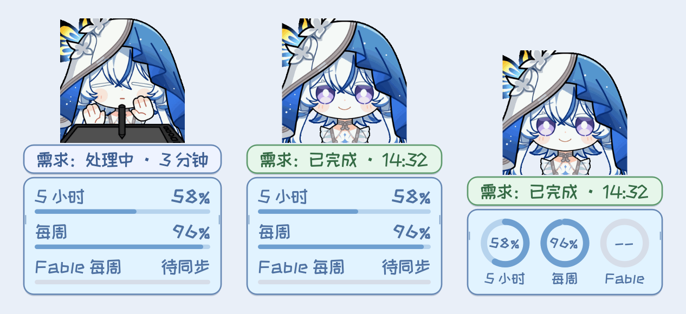

# Shorekeeper for Claude

A customizable Windows companion for Claude Code: animated reactions to task progress, paired voice clips and captions, and an at-a-glance status bar showing whether your request is finished and how much usage is left.

[Download for Windows](https://github.com/Doya16/shorekeeper-claude-pet/releases/latest) · [Chinese guide](docs/USAGE.md) · [中文说明](README.md)

**v0.1.1 · Windows 10/11 x64.** Works with Code sessions in Claude Desktop and with terminal Claude Code. Ordinary chat and Cowork are not supported yet. Python is not required.

## Start

1. Extract `Shorekeeper-Claude-Windows-v0.1.1.zip` completely and run `守岸人Claude桌宠启动.exe`.
2. **Claude Desktop Code sessions need no setup.** Task state comes from local session transcripts; usage comes from the desktop app's local usage samples.
3. For terminal Claude Code only: right-click the pet → **设置… → Claude 额度与提醒** and enable the terminal connection (hooks plus status line), then start a new session. Claude Code 2.1.295 or later is recommended.

The pet reads local files only. It never reads credentials or sends model requests.

## Request status

The request pill tracks only the latest message **you** sent: in progress (blue), finished (green) or failed (orange). Turns Claude starts by itself (background task results, schedules, Monitor events, sessions started by another session) are silent by default, so they no longer replay start and finish sounds. You can switch them to animation only, or to full reminders.

## Status bar

Five-hour, weekly and Fable weekly usage share one box, each with its own remaining-usage bar, or as rings with the percentage in the centre. Every item can be shown or hidden, and the settings page previews exactly what the pet draws.

Usage comes from the Claude Desktop usage record (sampled about every 15 minutes) or the [Claude Code status line](https://code.claude.com/docs/en/statusline), whichever is newer. Fable usage appears only when Claude reports a Fable-specific window; today both sources report five-hour and weekly windows only. Missing values show as pending, and stale values carry a `*`.

## Menu and settings

The right-click menu keeps only everyday actions: pat, tea, a **Claude & usage** submenu (open Claude, open the usage page, refresh usage), **Settings…**, hide and quit. All settings live in one window: General, Interaction studio, Fonts & size, Sound, Status bar, Claude usage & reminders, Save & transfer, and Version & updates.

## Profiles

Settings save automatically. Export a settings snapshot, a profile ZIP with your media, or a full portable ZIP that includes the application. Credentials, conversations and usage caches are never included.

## Credits

Artwork source: [emoji.wuwa.games](https://emoji.wuwa.games/). Community crowdfunding QQ group: **1079834905**. Thank you to all Shorekeeper fans who contributed to the emote crowdfunding.

Character artwork and original voices belong to their respective rights holders. This is an unofficial fan companion, not an Anthropic or Kuro Games product. Component and font licenses are in `licenses/` and `THIRD_PARTY.txt`.
