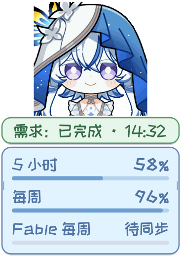
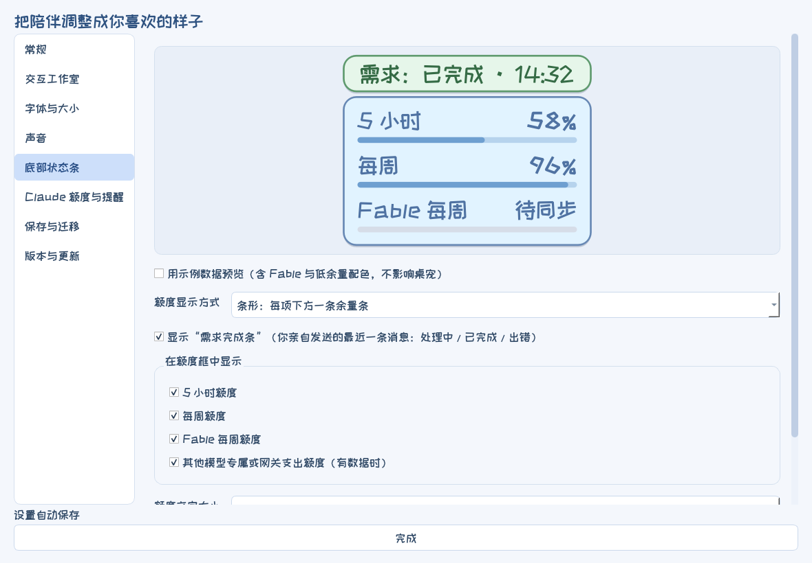
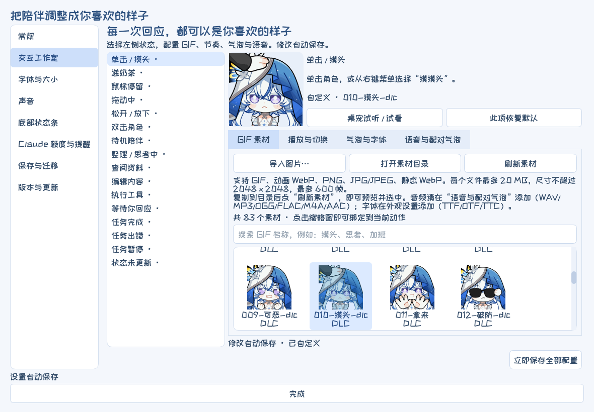

# 守岸人 Claude 桌宠

让守岸人陪你使用 **Claude Code**。任务进行时换表情，完成后用语音和气泡回应；底部一眼看清“需求有没有处理完”和剩余额度。

[Windows 下载](https://github.com/Doya16/shorekeeper-claude-pet/releases/latest) · [使用指南](docs/USAGE.md) · [English](README.en.md)


适用于 **Windows 10/11 x64**。完整包内置 **三套 83 个 GIF、40 个音频文件、语音字幕配对和两款字体**，无需安装 Python。可与 [Codex 版](https://github.com/Doya16/shorekeeper-codex-pet)、[DeepSeek 版](https://github.com/Doya16/shorekeeper-deepseek-pet) 同时使用，分别保存设置。

支持 **Claude 桌面版中的 Code 会话** 与 **终端 Claude Code**。普通聊天和 Cowork 尚未适配。

## 开始使用

1. 下载 **Shorekeeper-Claude-Windows-v0.1.0.zip**，完整解压到可写目录。
2. 双击 **守岸人Claude桌宠启动.exe**。
3. **Claude 桌面版的 Code 会话无需任何设置**：任务状态读取本机会话记录，额度读取桌面版写在本机的用量记录。
4. 只用 **终端 Claude Code** 时：右键桌宠 → **设置… → Claude 额度与提醒**，勾选 **终端 Claude Code：安装任务事件与额度状态栏**，然后重新打开终端会话（建议 Claude Code 2.1.295 或更高版本）。

首次启动不修改 Claude 设置，不启用开机联动。桌宠只读取本机文件，不读取账号凭据，也不会替你发送任何模型请求。

## 需求到底处理好了没有

底部的 **需求完成条** 只跟踪你亲自发送的最近一条消息：

| 显示 | 含义 |
| --- | --- |
| **处理中 · N 分钟**（蓝） | Claude 还在处理你的需求 |
| **已完成 · 14:32**（绿） | 这一轮已经回复完毕 |
| **出错了 · 14:32**（橙） | 这一轮异常结束，回到 Claude 查看 |

Claude 的工作流里有很多 **它自己发起的轮次**：后台命令或子任务完成后的回报、定时任务、Monitor 事件、由其他会话新建的会话。默认 **静音**：它们不再反复触发“开始／完成”的语音、动画和提醒；也可以改为“仅动画”或“完整提醒”。如果后台结果在你的需求还没结束时送达，它算作这条需求的一部分。

悬停桌宠或打开右键菜单，可以看到会话名称（与 Claude 侧栏一致）、用时，以及有几个后台任务在运行。

## 底部状态条

| 条形 | 圆环 |
| --- | --- |
|  |  |

5 小时、每周、Fable 每周额度合并在同一个框里，每项都有自己的余量条或圆环；余量低于 20% 时变为橙色。在 **设置… → 底部状态条** 中：

- 选择 **条形** 或 **圆环**（环中显示剩余百分比）；
- 单独勾选显示哪些额度，以及是否显示需求完成条；
- 顶部预览与桌宠底部完全一致，勾选“用示例数据预览”可在没有数据时查看效果。



## Claude 额度怎么看

额度有两个本机来源，显示较新的一个：

- **Claude 桌面版用量记录**：桌面版打开期间约每 15 分钟采样，自动读取；超过 20 分钟未更新显示 `*`。
- **Claude Code 状态栏**：终端会话勾选连接后可用，带重置时间；超过 5 分钟未更新显示 `*`。

每项独立计算，不能相加。没有数据的项显示 **待同步**，到期窗口不会被假定为 100%。**Fable 额度** 只有在 Claude 返回 Fable 专属窗口时才有数值；目前桌面版用量记录与[官方状态栏](https://code.claude.com/docs/en/statusline)都只提供 5 小时和每周，不需要时可在设置中隐藏。会话上下文与费用估算不是套餐额度，额外用量余额暂未获取。

## 右键菜单与设置


右键菜单只保留常用操作：摸摸头、递奶茶、**Claude 与额度**（打开 Claude、打开官方用量页面、刷新额度）、**设置…**、收起与退出。所有设置集中在同一个窗口：

| 页面 | 内容 |
| --- | --- |
| 常规 | 表情风格、保持置顶、精简气泡、进度文字 |
| 交互工作室 | 每个动作的 GIF、播放节奏、气泡与字体、语音与配对字幕 |
| 字体与大小 | 整体缩放、字体字号、气泡与额度框大小（实时预览） |
| 声音 | 语音开关、音量、播报间隔、音频目录 |
| 底部状态条 | 需求完成条、额度项、条形／圆环（实时预览） |
| Claude 额度与提醒 | 额度来源状态、终端连接、后台任务提醒、跟随会话、随 Claude 启动 |
| 保存与迁移 | 配置快照、配置与素材包、Windows 便携完整包、导入 |
| 版本与更新 | 启动检查更新、手动检查 |



**精简气泡** 只影响文字气泡、不影响语音：思考、查阅、编辑、执行、待机等进度状态不再弹出默认台词；完成、出错、等你回应和互动照常显示。

Ctrl + 滚轮缩放桌宠；拖动气泡或额度框左右边缘调整宽度。GIF 列表支持 **GIF / WebP / PNG / JPG / JPEG**，语音支持 **WAV / MP3 / OGG / FLAC / M4A / AAC**，字体支持 **TTF / OTF / TTC**。

## 保存、迁移与升级

修改自动保存在 `settings.json`。在 **设置… → 保存与迁移** 中可以导出配置快照、配置与素材包（GIF、气泡文案、配对字幕、音频、字体与设置），或包含运行程序的 Windows 便携完整包。迁移包不包含 Claude 账号凭据、聊天记录或额度缓存。Codex / DeepSeek 版的配置与素材 ZIP 也可以导入。

每次启动可在后台检查 GitHub 正式版本（默认关闭，可在 **版本与更新** 开启）。更新提醒不会自动下载或覆盖本地配置。升级时把新版本解压到新目录，再导入自己的配置与素材包。

## 从源码运行

```bash
pip install -r requirements.txt
python tools/run_pet.py
```

测试：`python -m unittest discover -s tests`。打包：`pip install -r tools/requirements-build.txt` 后运行 `python tools/build_portable.py`。

## 素材来源

表情包来源：[鸣潮表情包站](https://emoji.wuwa.games/)

**表情包众筹 QQ 群：1079834905**

感谢所有为该项目表情包众筹投资的守岸人厨子们。

角色、原版语音与相关游戏内容属于各自权利人。本项目为非官方同人桌面工具，与 Anthropic、Claude 或库洛游戏不存在官方合作关系。字体及组件许可见 `licenses/` 与 `THIRD_PARTY.txt`。
